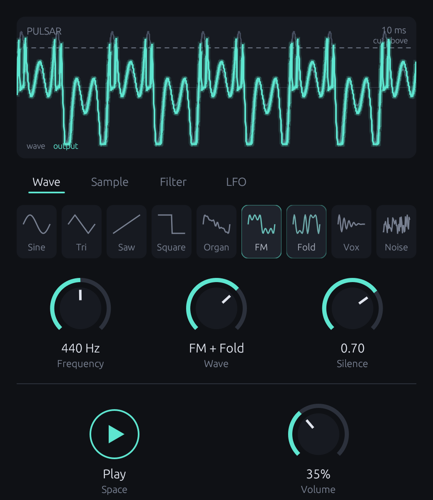

# Pulsar



Pulsar is a small standalone synth built around pulsar synthesis! A sound repeats in fast cycles, while you control the silence carved into each wave. You can choose between nine different wave-shapes, shaping your sound with the built in LFO and filter. 

## Build

You need a recent Rust toolchain. Dependencies will be downloaded on the first build.

```bash
cargo run --release -p gui
```

The app is built to `target/release/gui`. To run the tests, run `cargo test -p synth`.


Credits:
Inspired by https://www.youtube.com/watch?v=gp6b8a1Bz6o